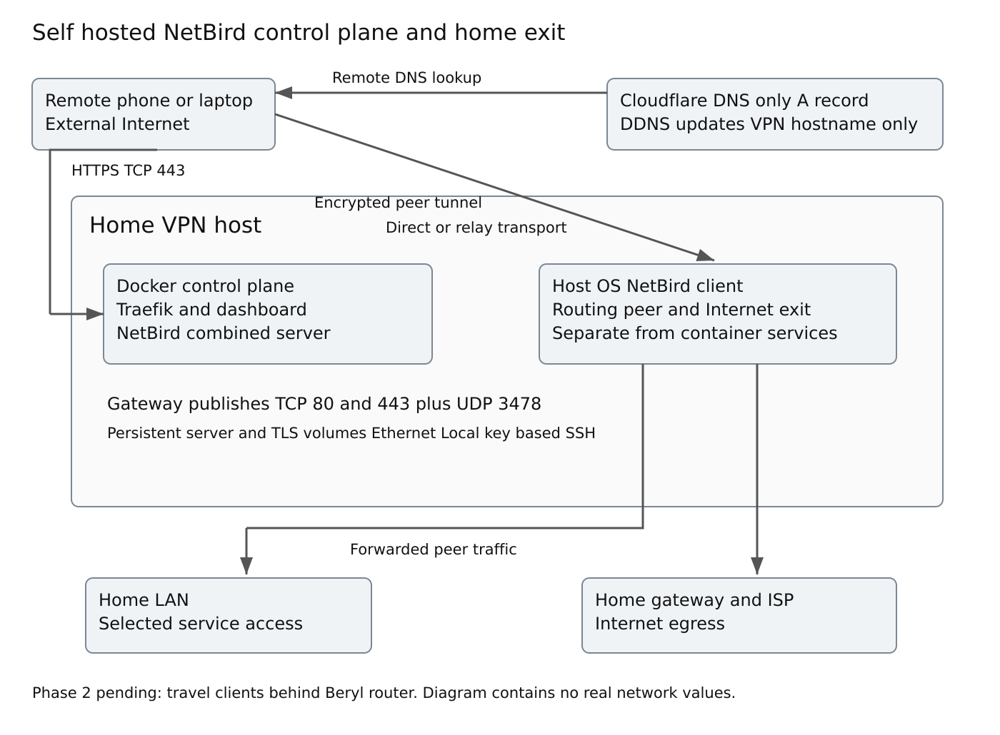

# Building a Self Hosted Travel VPN with NetBird and Cloudflare DDNS

A practical walkthrough of a home exit node and remote LAN access

Phase 1 is complete: a repurposed Linux laptop hosts NetBird, routes an authorized remote phone to the home LAN, and provides a home Internet exit. The host recovered automatically after reboot. The travel router remains a separate, pending phase.

The useful part of this build was getting a residential deployment to work reliably: keeping a laptop awake, maintaining one DNS record when the ISP address changes, handling a gateway without reliable NAT loopback, checking Docker exposure, and backing up the state needed for recovery.

## 1 Scope and evidence

This guide records the implementation and tests completed during the build. Commands marked **reproduction example** illustrate how to reproduce or verify a step; they are not a verbatim terminal transcript. The accompanying scripts are reconstructed, sanitized examples rather than exports of the running server. They have been checked locally, but have not been executed against the live VPN host or Cloudflare account.

The exact installed NetBird, Traefik, Docker, kernel, and client versions were not retained in this public record. Record those privately before an upgrade. Do not treat an example image tag or today's installer as the historical deployed version.

**Privacy note:** all network-specific values are placeholders. Replace them locally before use. A placeholder such as `<VPN_HOST_LAN_IP>` is not valid configuration. Keep populated files outside this repository.

| Placeholder | Meaning |
| --- | --- |
| `<VPN_HOST>` | Generic name for the home Linux laptop |
| `<VPN_HOST_LAN_IP>` | Reserved IPv4 address of that laptop |
| `<HOME_LAN_CIDR>` | Trusted home LAN subnet |
| `<HOME_GATEWAY_IP>` | Home gateway address |
| `<VPN_DOMAIN>` | Fully qualified VPN hostname |
| `<ADMIN_EMAIL>` | Administrator and certificate contact |
| `<CLOUDFLARE_ZONE_ID>` | DNS zone identifier |
| `<CLOUDFLARE_API_TOKEN>` | Restricted DNS API credential |
| `<NETBIRD_SETUP_KEY>` | One-off peer enrollment credential |
| `<DEPLOYMENT_DIRECTORY>` | Private NetBird Compose directory |
| `<NETBIRD_VOLUME>` | Actual server data volume name |
| `<TRAEFIK_VOLUME>` | Actual certificate volume name |

## 2 Architecture and trust boundaries

The control plane and routing peer run on the same physical host. Docker hosts the control plane; the NetBird Linux client runs on the host OS. These are distinct roles. A working dashboard does not prove that LAN forwarding or Internet exit works.

The control plane coordinates peer identity and connectivity. Remote device traffic uses an encrypted peer tunnel to the home routing peer, directly when possible or through relay transport when required. Traefik terminates the public web TLS connections; it is not the home Internet routing engine.



The stack comprises Kali Linux, Docker and Compose, self-hosted NetBird, the host NetBird client, Traefik, Let's Encrypt, Cloudflare DNS and DDNS, systemd, OpenSSH, and iptables/ip6tables with an nftables compatibility backend. The residential gateway provides the inbound port mappings. The planned Beryl AX will later carry traffic for travel devices behind it.

**Security note:** the home exit route is a broad authorization. Current NetBird guidance explains that a default route can also reach networks reachable by the exit host. Separate LAN resources do not, by themselves, prove that every other reachable LAN destination is blocked. This build validated access to a selected LAN device; it did not establish exhaustive LAN isolation for exit clients. For stronger separation, an Internet-only exit host or upstream segmentation needs separate design and testing. [3]

## 3 Prepare the laptop for always on operation

Kali was used because it was already installed on the spare laptop. This is a record of that choice, not a requirement to use a security-testing distribution for production VPN hosting. The same architecture can be adapted to other Debian-based systems.

The laptop uses Ethernet only. Wi-Fi was disabled, reducing interface ambiguity and avoiding dependence on wireless connectivity. The gateway reserves its IPv4 lease as `<VPN_HOST_LAN_IP>`; the LAN is represented as `<HOME_LAN_CIDR>`.

### Ethernet Wi Fi and the reserved address

**Reproduction example:** if NetworkManager manages this laptop, disable Wi-Fi and inspect the active Ethernet connection. These commands do not create a new network configuration file.

```bash
nmcli radio wifi off
nmcli radio wifi
nmcli device status
ip -4 address show
ip route show default
```

Confirm Wi-Fi reports disabled and the Ethernet interface has the reserved address. Verify again after reboot. If another network manager is used, use its native settings instead; do not overwrite its configuration with a guessed file.

In the gateway's DHCP reservation settings, select the Ethernet device and reserve `<VPN_HOST_LAN_IP>`. The Ethernet MAC address is needed privately but must not be included in public screenshots. Retain DHCP on the host unless a manual static-address configuration was actually used. Renew the lease or restart during maintenance, then confirm the address and default gateway. This build uses a gateway DHCP reservation; no manual static network file is required.

Lid-close behavior was changed so closing the laptop does not take down the VPN. These were the configured values:

```ini
HandleLidSwitch=ignore
HandleLidSwitchExternalPower=ignore
HandleLidSwitchDocked=ignore
```

**Reproduction example:** place those entries under `[Login]` in a logind drop-in. Create the parent directory if needed.

```bash
sudo install -d -m 755 /etc/systemd/logind.conf.d
sudoedit /etc/systemd/logind.conf.d/always-on.conf
```

```ini
[Login]
HandleLidSwitch=ignore
HandleLidSwitchExternalPower=ignore
HandleLidSwitchDocked=ignore
```

Keep the logind drop-in root-owned with mode `644`. The `[Login]` heading is required. Its contents are already shown in full above.

```bash
sudo chown root:root /etc/systemd/logind.conf.d/always-on.conf
sudo chmod 644 /etc/systemd/logind.conf.d/always-on.conf
```

Suspend and hibernate targets were masked. An equivalent command is:

```bash
sudo systemctl mask sleep.target suspend.target \
  hibernate.target hybrid-sleep.target
systemctl is-enabled sleep.target suspend.target \
  hibernate.target hybrid-sleep.target
```

**Expected result:** the targets report `masked`. Apply the logind change during a planned restart or maintenance window, then test with the lid closed. A desktop power manager may also affect lid behavior; verify operation rather than relying on the configuration file alone. Maintain cooling and stable power for continuous operation.

## 4 Harden local SSH administration

An ED25519 key pair was created on the Windows administration workstation:

```powershell
ssh-keygen -t ed25519 -a 100
```

### Install the public key before changing SSH authentication

If SSH is not yet installed, the following is a fresh-host reproduction step:

```bash
sudo apt install openssh-server
sudo systemctl enable --now ssh
```

The target account is represented by `<ADMIN_USER>`. On Windows, the default public-key file from the earlier command is shown below. Use the actual selected key path if you changed it during generation.

```powershell
scp "$env:USERPROFILE\.ssh\id_ed25519.pub" `
  '<ADMIN_USER>@<VPN_HOST_LAN_IP>:admin-key.pub'
```

While logged in as that non-root Linux account, create or preserve its key-authorization file. Append only the new public-key line; do not replace existing authorized keys.

```bash
umask 077
mkdir -p "$HOME/.ssh"
cat "$HOME/admin-key.pub" >> "$HOME/.ssh/authorized_keys"
chmod 700 "$HOME/.ssh"
chmod 600 "$HOME/.ssh/authorized_keys"
rm "$HOME/admin-key.pub"
stat -c '%U:%G %a %n' "$HOME/.ssh" "$HOME/.ssh/authorized_keys"
```

Both paths should belong to the target account. `authorized_keys` contains the complete public-key line in this format; the placeholder is not a real key:

```text
ssh-ed25519 <PUBLIC_KEY_BASE64> <OPTIONAL_KEY_COMMENT>
```

Test a new Windows session using the private key before disabling passwords:

```powershell
ssh -i "$env:USERPROFILE\.ssh\id_ed25519" `
  '<ADMIN_USER>@<VPN_HOST_LAN_IP>'
```

A prompt for the local key passphrase is different from an SSH account-password prompt. Keep the original connection available while testing.

Only the public key belongs in the server's `authorized_keys`; the private key stays on the administration workstation. Key-based login was verified before password authentication was disabled.

The SSH hardening drop-in is `/etc/ssh/sshd_config.d/10-local-hardening.conf`. Create it as a root-owned file with mode `644`. Its full contents are:

```text
PermitRootLogin no
PubkeyAuthentication yes
PasswordAuthentication no
KbdInteractiveAuthentication no
PermitEmptyPasswords no
X11Forwarding no
```

**Reproduction example:** use a dedicated configuration drop-in, then verify syntax and effective settings. Existing includes and match blocks can change the result.

```bash
sudo install -d -m 755 /etc/ssh/sshd_config.d
sudoedit /etc/ssh/sshd_config.d/10-local-hardening.conf
sudo chown root:root /etc/ssh/sshd_config.d/10-local-hardening.conf
sudo chmod 644 /etc/ssh/sshd_config.d/10-local-hardening.conf
sudo sshd -t
sudo sshd -T | rg 'permitrootlogin|pubkeyauthentication|passwordauthentication'
sudo sshd -T | rg 'kbdinteractiveauthentication|permitemptypasswords|x11forwarding'
sudo systemctl reload ssh
```

If `rg` is unavailable, inspect `sshd -T` directly. Keep the current session open and verify a fresh key-based connection before closing it. SSH was available locally and was intentionally not forwarded through the Internet gateway. VPN-based administrative access would also require explicit policy and firewall authorization; it should not be assumed from LAN routing alone.

## 5 Install and verify Docker

Docker and the Compose plugin were installed, Docker was enabled at boot, and a test container ran before NetBird deployment. The initial installation needed cleanup; the precise package/repository error and repair commands were not preserved here, so this guide does not invent them.

**Current reproduction example:** Kali's official instructions distinguish `docker.io` from the unrelated package named `docker`. For a fresh host using Kali packages, verify package availability before installation. Do not mix this route with an existing Docker CE installation. [4]

```bash
sudo apt update
apt-cache policy docker.io docker-compose-v2
sudo apt install docker.io docker-compose-v2 curl jq
sudo systemctl enable --now docker
sudo docker run --rm hello-world
```

Verification commands:

```bash
systemctl status docker --no-pager
sudo docker --version
sudo docker compose version
```

**Expected result:** Docker is active, the test container exits successfully, and `docker compose` reports a version. Use `sudo` unless access has been deliberately delegated. Membership in the Docker group grants powerful host access and should be treated accordingly.

## 6 Configure DNS and automatic address updates

The home connection has a real, dynamic public IPv4 address. Cloudflare hosts an A record for `<VPN_DOMAIN>`, configured **DNS-only**. The record points to the home public IPv4, not the reserved private host address. The NetBird hostname is not passed through Cloudflare's HTTP proxy.

A restricted Cloudflare API token was scoped to the relevant zone with the DNS permissions needed to inspect and update the record. Do not confuse zone-scoped permissions with record-only permissions: the script narrows its behavior to the VPN record, while a token with zone DNS edit permission may still modify other records in that zone.

### Create the VPN DNS record and API token

In Cloudflare, select the zone hosting the VPN hostname. Create one A record with the name corresponding to `<VPN_DOMAIN>`, the current `<PUBLIC_IPV4>`, and proxy status set to DNS-only. Automatic TTL is suitable for this reproduction example. Do not change the website's existing root-domain or other records.

Create an API token granting Zone DNS Edit for that selected zone. Keep the zone identifier and token in the private configuration below. Never include the token in a URL, screenshot, repository, or command history. A zone-scoped token is not restricted to one record; the script enforces the narrower single-hostname behavior.

The A record must exist before the example updater runs. The updater deliberately refuses to create records or choose between duplicate matches. An AAAA record is not required for the documented IPv4 DDNS mechanism; do not create one merely because IPv6 exit testing succeeded.

The deployed DDNS arrangement consists of:

```text
/etc/cloudflare-ddns.conf
/usr/local/sbin/cloudflare-ddns.sh
/etc/systemd/system/cloudflare-ddns.service
/etc/systemd/system/cloudflare-ddns.timer
```

The credential file is owned by `root:root` with mode `600`. The script determines the current public IPv4, reads the current Cloudflare A record, and updates it only when the address changes. The timer remains enabled across reboot.

**Reproduction example:** the package includes a replacement script with explicit safeguards. It selects exactly one A record by full hostname, refuses an ambiguous or proxied result, validates the detected IPv4, and uses a PATCH that changes only record content. It never updates the root domain, other subdomains, or AAAA records. These safeguards describe this example, not a byte-for-byte audit of the original script. Cloudflare's records API supports filtered listing and record updates. [5]

### DDNS credential configuration

File: `/etc/cloudflare-ddns.conf`. Required ownership: `root:root`; mode: `600`. This is shell syntax because the updater sources it. Every value is quoted. Its complete sanitized example is:

```bash
# EXAMPLE ONLY
# Replace placeholders locally; never commit the populated file.
# This is a root-sourced shell configuration, not an untrusted data file.
CLOUDFLARE_API_TOKEN='<CLOUDFLARE_API_TOKEN>'
CLOUDFLARE_ZONE_ID='<CLOUDFLARE_ZONE_ID>'
VPN_DOMAIN='<VPN_DOMAIN>'
# Public service endpoint, not a private network value. Choose deliberately.
PUBLIC_IPV4_URL='https://api.ipify.org'
```

`CLOUDFLARE_API_TOKEN` authorizes the request, `CLOUDFLARE_ZONE_ID` selects the zone, and `VPN_DOMAIN` selects the exact A-record hostname. `PUBLIC_IPV4_URL` is the chosen HTTPS address-discovery service. The example contains a public provider endpoint, not the home address. Edit the populated file only on the private host.

### DDNS updater script

File: `/usr/local/sbin/cloudflare-ddns.sh`. Required ownership: `root:root`; mode: `700`. Dependencies are Bash, curl, jq, Python 3, flock, stat, and mktemp. On a Debian-based host, install missing packages before using the service:

```bash
sudo apt install curl jq python3 util-linux coreutils
```

The complete reconstructed updater is below. It reads the root-only configuration, prevents simultaneous runs, validates a global IPv4, selects exactly one existing DNS-only A record, and patches only its content. It does not expose the token in curl's argument list. The script exits with failure rather than guessing when selection or API validation fails.

```bash
#!/usr/bin/env bash
# EXAMPLE ONLY -- reconstructed; not exported from the live server.
# Updates only ONE existing DNS-only A record for VPN_DOMAIN.
# Dependencies: bash, curl, jq, python3, flock, stat, mktemp.
set -euo pipefail
umask 077
config=/etc/cloudflare-ddns.conf
[[ $EUID -eq 0 ]] || { echo 'Run as root' >&2; exit 1; }
[[ -f $config && ! -L $config ]] || { echo 'Missing regular config' >&2; exit 1; }
[[ $(stat -c '%u:%g:%a' "$config") == '0:0:600' ]] || {
  echo 'Config must be root:root mode 600' >&2; exit 1;
}
# Only source a reviewed root-owned configuration.
# shellcheck source=/dev/null
source "$config"
for value in "${CLOUDFLARE_API_TOKEN:-}" "${CLOUDFLARE_ZONE_ID:-}" \
  "${VPN_DOMAIN:-}" "${PUBLIC_IPV4_URL:-}"; do
  [[ -n $value && $value != *'<'* && $value != *'>'* ]] || {
    echo 'Configuration has missing values or placeholders' >&2; exit 1;
  }
done
[[ $CLOUDFLARE_ZONE_ID =~ ^[a-fA-F0-9]{32}$ ]] || {
  echo 'Invalid zone identifier' >&2; exit 1;
}
# Reject characters that could become curl configuration directives.
[[ $CLOUDFLARE_API_TOKEN =~ ^[a-zA-Z0-9_-]+$ ]] || {
  echo 'Invalid token format' >&2; exit 1;
}
[[ $VPN_DOMAIN =~ ^[a-zA-Z0-9]([a-zA-Z0-9.-]*[a-zA-Z0-9])?$ \
  && $VPN_DOMAIN == *.* ]] || { echo 'Invalid hostname' >&2; exit 1; }
exec 9>/run/lock/cloudflare-ddns.lock
flock -n 9 || exit 0
work=$(mktemp -d)
trap 'rm -rf -- "$work"' EXIT
# Keep the API token out of the curl process argument list.
printf 'header = "Authorization: Bearer %s"\n' \
  "$CLOUDFLARE_API_TOKEN" > "$work/auth"
public_ipv4=$(curl -4 -fsS --connect-timeout 10 --max-time 30 \
  --proto '=https' "$PUBLIC_IPV4_URL")
python3 - "$public_ipv4" <<'PY'
import ipaddress, sys
try:
    address = ipaddress.ip_address(sys.argv[1])
    assert address.version == 4 and address.is_global
except (ValueError, AssertionError):
    raise SystemExit('Address provider did not return a global IPv4')
PY
api="https://api.cloudflare.com/client/v4/zones/$CLOUDFLARE_ZONE_ID/dns_records"
curl -fsS --connect-timeout 10 --max-time 30 --proto '=https' \
  --config "$work/auth" --get "$api" \
  --data-urlencode 'type=A' --data-urlencode "name=$VPN_DOMAIN" \
  --data-urlencode 'per_page=100' > "$work/records"
jq -e '.success == true and (.result | length) == 1' \
  "$work/records" >/dev/null || {
  echo 'API failed or record selection was ambiguous' >&2; exit 1;
}
jq -e --arg name "${VPN_DOMAIN,,}" \
  '.result[0] | .type == "A" and (.name | ascii_downcase) == $name
    and .proxied == false' "$work/records" >/dev/null || {
  echo 'Selected record must match the hostname and be DNS-only' >&2; exit 1;
}
record_id=$(jq -r '.result[0].id' "$work/records")
[[ $record_id =~ ^[a-fA-F0-9]{32}$ ]] || {
  echo 'Invalid record identifier' >&2; exit 1;
}
current_ipv4=$(jq -r '.result[0].content' "$work/records")
if [[ $current_ipv4 == "$public_ipv4" ]]; then
  echo 'A record unchanged'
  exit 0
fi
jq -n --arg address "$public_ipv4" '{content:$address}' > "$work/payload"
# PATCH content only: leave TTL, name, comments, other records and AAAA untouched.
curl -fsS --connect-timeout 10 --max-time 30 --proto '=https' \
  --config "$work/auth" -X PATCH "$api/$record_id" \
  -H 'Content-Type: application/json' --data-binary "@$work/payload" \
  > "$work/update"
jq -e --arg address "$public_ipv4" --arg name "${VPN_DOMAIN,,}" \
  '.success == true and .result.content == $address and .result.type == "A"
    and (.result.name | ascii_downcase) == $name and .result.proxied == false' \
  "$work/update" >/dev/null || { echo 'Update validation failed' >&2; exit 1; }
echo 'A record updated'
```

### DDNS service unit

File: `/etc/systemd/system/cloudflare-ddns.service`. Required ownership: `root:root`; mode: `644`. Complete reconstructed contents:

```ini
# EXAMPLE ONLY -- reconstructed unit.
[Unit]
Description=Update the VPN hostname A record
Wants=network-online.target
After=network-online.target

[Service]
Type=oneshot
User=root
UMask=0077
ExecStart=/usr/local/sbin/cloudflare-ddns.sh
NoNewPrivileges=yes
PrivateTmp=yes
ProtectHome=yes
ProtectSystem=strict
ReadWritePaths=/run/lock
```

`Type=oneshot` runs one check and exits. `ExecStart` points to the updater. Network-online ordering delays execution until the host's configured network readiness mechanism completes; it does not guarantee Internet availability. The sandbox allows the lock file under `/run/lock` and uses a private temporary directory. This service has no `[Install]` section because the timer triggers it.

### DDNS timer unit

File: `/etc/systemd/system/cloudflare-ddns.timer`. Required ownership: `root:root`; mode: `644`. Complete reconstructed contents:

```ini
# EXAMPLE ONLY -- timing values are examples, not historical settings.
[Unit]
Description=Periodically check the VPN public IPv4

[Timer]
OnBootSec=2min
OnUnitActiveSec=5min
RandomizedDelaySec=30s
Unit=cloudflare-ddns.service

[Install]
WantedBy=timers.target
```

The example starts a check approximately two minutes after boot, then five minutes after the service's last activation, with up to 30 seconds of randomized delay. These are suggested intervals for this example; the original timer intervals were not verified. `Unit` binds the timer to the updater service; `WantedBy` allows enabling it at boot. Failed checks are attempted again on subsequent timer activations.

### Install the files and activate the timer

If using the accompanying repository, run the installation commands below from its root, where `examples/` exists. Alternatively, open each target path with `sudoedit` and paste the complete contents shown above. Create all four files before activation; populate the credential configuration and check syntax first.

```bash
sudo install -o root -g root -m 600 \
  examples/cloudflare-ddns.example.conf /etc/cloudflare-ddns.conf
sudoedit /etc/cloudflare-ddns.conf
sudo install -o root -g root -m 700 \
  examples/cloudflare-ddns.example.sh /usr/local/sbin/cloudflare-ddns.sh
sudo install -o root -g root -m 644 \
  examples/cloudflare-ddns.service /etc/systemd/system/cloudflare-ddns.service
sudo install -o root -g root -m 644 \
  examples/cloudflare-ddns.timer /etc/systemd/system/cloudflare-ddns.timer
sudo bash -n /usr/local/sbin/cloudflare-ddns.sh
sudo systemd-analyze verify /etc/systemd/system/cloudflare-ddns.service \
  /etc/systemd/system/cloudflare-ddns.timer
sudo systemctl daemon-reload
sudo systemctl start cloudflare-ddns.service
sudo systemctl enable --now cloudflare-ddns.timer
```

Populate and inspect the configuration locally before starting the service. The example uses an HTTPS public-address lookup provider; choose one appropriate for the environment. A single provider is an availability dependency. Test a repeated run when the address has not changed:

```bash
sudo systemctl start cloudflare-ddns.service
systemctl list-timers cloudflare-ddns.timer --all
sudo journalctl -u cloudflare-ddns.service -n 20 --no-pager
```

**Expected result:** a successful check reports either `A record updated` or `A record unchanged`, without printing credentials or addresses. The timer schedules another run. An enabled timer alone does not prove a successful API call. Compare the exact record privately in Cloudflare and public DNS; DNS caching can delay visible convergence.

## 7 Forward only the required public ports

The AT&T gateway forwards these ports to `<VPN_HOST_LAN_IP>`:

| Protocol | Port | Role |
| --- | --- | --- |
| TCP | 80 | HTTP entry point and certificate validation or redirects |
| TCP | 443 | HTTPS dashboard and NetBird service endpoints through Traefik |
| UDP | 3478 | STUN used for peer connectivity discovery |

These are the mappings actually used. No public TCP/22 rule, DMZ mode, or IP Passthrough was required. Gateway menu names depend on model and firmware; this guide does not assume a particular configuration screen.

The current combined-server documentation also describes the public STUN port and reverse-proxy routing. Earlier NetBird layouts can have different port requirements; use the documentation matching the deployed version rather than opening every port from older guides. [2]

### Gateway rule fields

Each rule needs its protocol, matching external and internal port, and destination device or reserved host address. Create separate TCP/80, TCP/443, and UDP/3478 mappings; use equal external and internal ports. Confirm the destination is the Ethernet reservation, not a stale lease or wireless device. Save and verify that the rules remain assigned after reboot.

This configuration lives in the gateway's interface, not a Linux file. Export or record it privately if supported. Exact menu navigation depends on the gateway model; it cannot be reconstructed from the port list alone.

Test the hostname from cellular or another external connection. A LAN-only test can hide external firewall problems or fail for a completely different reason, such as NAT loopback.

## 8 Apply host input filtering

The host uses an idempotent firewall script at `/usr/local/sbin/host-firewall.sh`, applied by `/etc/systemd/system/host-firewall.service`. It allows loopback, established/related traffic, ICMP, SSH from the trusted LAN, and the intended public service ports. Other unsolicited host inbound traffic is dropped. IPv6 received separate attention.

The supplied `host-firewall.example.sh` reconstructs this host-input policy using dedicated chains. It leaves Docker's and NetBird's forwarding/NAT rules intact. It also includes IPv6 ICMP and DHCPv6 replies for IPv6 operation, but does not grant new IPv6 SSH access.

**Security note:** host `INPUT` filtering does not establish container port isolation. Docker-published traffic may traverse forwarding chains instead. Audit published ports and upstream filtering as described in section 15. The example does not add `DOCKER-USER` restrictions or claim to constrain tunneled LAN forwarding. [6]

**Reproduction example:** fill in `<HOME_LAN_CIDR>`, review from a local console, and apply during a maintenance window. Rebuilding a chain can briefly interrupt new inbound connections.

### Host firewall script

File: `/usr/local/sbin/host-firewall.sh`. Required ownership: `root:root`; mode: `700`. Replace `trusted_lan` with the trusted IPv4 subnet before applying. `RDN-HOST-IN` is an example chain name, not a generated identifier from the real environment. Dependencies are Bash, Python 3, iptables and ip6tables.

```bash
#!/usr/bin/env bash
# EXAMPLE ONLY -- reconstructed host INPUT filter, not a forwarding firewall.
# Review and populate at a local console. Do not flush Docker/NetBird chains.
# Reapplying rebuilds this chain; briefly interrupted new inbound traffic is possible.
set -euo pipefail
trusted_lan='<HOME_LAN_CIDR>'
chain=RDN-HOST-IN
[[ $EUID -eq 0 ]] || { echo 'Run as root' >&2; exit 1; }
python3 - "$trusted_lan" <<'PY'
import ipaddress, sys
try:
    network = ipaddress.ip_network(sys.argv[1], strict=True)
    assert network.version == 4 and network.is_private
except (ValueError, AssertionError):
    raise SystemExit('Replace HOME_LAN_CIDR with the trusted private IPv4 subnet')
PY
for command in iptables ip6tables; do
  command -v "$command" >/dev/null
  "$command" -w -N "$chain" 2>/dev/null || "$command" -w -S "$chain" >/dev/null
  "$command" -w -F "$chain"
  "$command" -w -A "$chain" -i lo -j ACCEPT
  "$command" -w -A "$chain" -m conntrack \
    --ctstate ESTABLISHED,RELATED -j ACCEPT
  if [[ $command == iptables ]]; then
    "$command" -w -A "$chain" -p icmp -j ACCEPT
    "$command" -w -A "$chain" -p tcp -s "$trusted_lan" --dport 22 -j ACCEPT
  else
    # Neighbor discovery and path MTU rely on ICMPv6.
    "$command" -w -A "$chain" -p ipv6-icmp -j ACCEPT
    # Accommodate DHCPv6 on the host; review interface scope for your network.
    "$command" -w -A "$chain" -p udp --sport 547 --dport 546 -j ACCEPT
  fi
  "$command" -w -A "$chain" -p tcp -m multiport --dports 80,443 -j ACCEPT
  "$command" -w -A "$chain" -p udp --dport 3478 -j ACCEPT
  "$command" -w -A "$chain" -j DROP
  # A single first-position jump controls unsolicited host input.
  while "$command" -w -C INPUT -j "$chain" 2>/dev/null; do
    "$command" -w -D INPUT -j "$chain"
  done
  "$command" -w -I INPUT 1 -j "$chain"
done
# Intentionally do not change FORWARD, NAT, DOCKER-USER or NetBird rules.
```

### Host firewall boot service

File: `/etc/systemd/system/host-firewall.service`. Required ownership: `root:root`; mode: `644`. Complete reconstructed contents:

```ini
# EXAMPLE ONLY -- reconstructed unit.
[Unit]
Description=Apply the reviewed host input firewall
After=network-pre.target
Before=network.target docker.service netbird.service
Wants=network-pre.target

[Service]
Type=oneshot
ExecStart=/usr/local/sbin/host-firewall.sh
RemainAfterExit=yes

[Install]
WantedBy=multi-user.target
```

`Before` orders this service ahead of the named network, Docker and NetBird services when they participate in the boot transaction. `RemainAfterExit=yes` makes successful application remain visible as active after the script exits. There is no automatic rule-removal action when stopping the unit. Ordering alone does not make Docker or NetBird fail startup if the firewall script fails; check the service result and effective rules.

### Install and verify the host firewall

Run from the project root, or create both targets from the full contents above. Review at a local console and retain a recovery path before enabling the unit.

```bash
sudo install -o root -g root -m 700 \
  examples/host-firewall.example.sh /usr/local/sbin/host-firewall.sh
sudoedit /usr/local/sbin/host-firewall.sh
sudo install -o root -g root -m 644 \
  examples/host-firewall.service /etc/systemd/system/host-firewall.service
sudo systemctl daemon-reload
sudo bash -n /usr/local/sbin/host-firewall.sh
sudo systemctl enable --now host-firewall.service
sudo iptables -S INPUT
sudo iptables -S RDN-HOST-IN
sudo ip6tables -S RDN-HOST-IN
```

**Expected result:** one jump to the dedicated chain for each address family, the intended allow rules, and a final DROP. Apply twice and confirm jumps are not duplicated. Verify new local SSH access and VPN operation separately.

## 9 Deploy the self hosted control plane

The official NetBird self-hosted installer was used with `<VPN_DOMAIN>`, built-in Traefik, and Let's Encrypt. The optional **NetBird Proxy** feature was disabled. That feature is distinct from Traefik and from NetBird's relay transport; disabling it does not mean all proxy or relay functions disappear.

The running deployment contained three main containers:

```text
netbird-server
netbird-dashboard
netbird-traefik
```

They share a Docker bridge network. Server state and Traefik certificate state use persistent volumes. The real generated network and volume identifiers are excluded from public material.

**Current reproduction example:** download the installer into a fresh private directory, inspect it, then run it. This is a reviewable equivalent of the official install flow, not a preserved historical command. [1]

```bash
mkdir -p '<DEPLOYMENT_DIRECTORY>'
cd '<DEPLOYMENT_DIRECTORY>'
curl -fsSL \
  https://github.com/netbirdio/netbird/releases/latest/download/getting-started.sh \
  -o getting-started.sh
less getting-started.sh
bash getting-started.sh
```

Select the VPN hostname and built-in Traefik option; leave the optional NetBird Proxy disabled. Complete administrator onboarding at `https://<VPN_DOMAIN>`. Use a strong, unique password.

Preserve the installer-generated configuration privately. The accompanying Compose example documents service topology; it intentionally refuses startup and is not a replacement for a generated deployment. A runnable sanitized export cannot be claimed without inspecting the actual source file. Do not manufacture server authentication keys or fill in a guessed `config.yaml` schema.

### Inventory installer generated configuration

The installer creates files in `<DEPLOYMENT_DIRECTORY>`. The deployment does not use the public topology file as its running Compose configuration. Inspect these generated files privately before starting a repeat deployment or making changes:

| File or state | What to document and preserve |
| --- | --- |
| `docker-compose.yml` | Actual image versions, service names, restart policies, network, published ports, mounts and Traefik options or labels |
| `config.yaml` | Combined-server endpoints, authentication configuration and generated secrets; preserve the full original privately |
| `dashboard.env` | Dashboard endpoint and authentication environment settings referenced by Compose |
| Server data volume | Accounts, enrolled peers, policies and other persistent server state |
| Traefik certificate volume | ACME account and certificate state including private keys |

These files are generated by running the installer in this section; the reader is not expected to invent them. The exact generated files were not supplied for this walkthrough, so the following explanations do not claim exact original contents.

### Docker Compose configuration

File: `<DEPLOYMENT_DIRECTORY>/docker-compose.yml`. The example below identifies the documented services, port bindings and mounts. It deliberately omits routing and generated settings and must not be substituted for installer output.

```yaml
# EXAMPLE ONLY -- topology illustration, NOT a deployable configuration.
# Replace placeholders and use the official generated Compose for your version.
# Omitted: generated server authentication settings, dashboard.env, all
# Traefik routers/h2c service labels, ACME resolver options and Docker discovery.
# The deliberate invalid image tag prevents accidental startup.
services:
  netbird-server:
    image: netbirdio/netbird-server:EXAMPLE-NOT-DEPLOYABLE
    restart: unless-stopped
    networks: [netbird]
    ports:
      - '3478:3478/udp'
    command: ['--config', '/etc/netbird/config.yaml']
    volumes:
      - netbird-data:/var/lib/netbird
      - ./config.yaml:/etc/netbird/config.yaml:ro
  dashboard:
    image: netbirdio/dashboard:EXAMPLE-NOT-DEPLOYABLE
    restart: unless-stopped
    networks: [netbird]
    env_file: [./dashboard.env]
    # No public dashboard backend port; actual HTTP routing is in Traefik.
  traefik:
    image: traefik:EXAMPLE-NOT-DEPLOYABLE
    restart: unless-stopped
    networks: [netbird]
    ports:
      - '80:80'
      - '443:443'
    volumes:
      - traefik-certificates:/letsencrypt
      - /var/run/docker.sock:/var/run/docker.sock:ro
    # A Docker socket mount is security-sensitive, even when mounted read-only.
    # Actual entrypoint, ACME and routing settings come from the installer.
networks:
  netbird:
    driver: bridge
volumes:
  netbird-data:
  traefik-certificates:
```

For the actual generated file, verify that only Traefik publishes TCP/80 and TCP/443 and the server publishes UDP/3478. The dashboard should be reached internally through Traefik, with no additional public backend port. Check restart policies for reboot recovery and confirm both persistent volumes are mounted.

Traefik configuration may be supplied through Compose command arguments and labels, rather than a separate `traefik.yml`. Document the mechanism actually present. Verify its HTTP/HTTPS entry points, certificate-contact email, ACME challenge/resolver, certificate-volume path, and routes to the dashboard and server. The server's gRPC path needs a compatible HTTP/2 backend. Do not introduce an extra proxy configuration file that was not used.

### Combined server configuration

File: `<DEPLOYMENT_DIRECTORY>/config.yaml`, mounted at `/etc/netbird/config.yaml` in the server container. Preserve the generated authentication material unchanged. A current-schema orientation excerpt is shown below, not a complete replacement file or a claim about the exact historical version. [2]

```yaml
# Orientation excerpt only. Preserve the installer's complete file.
server:
  exposedAddress: "https://<VPN_DOMAIN>:443"
  stunPorts:
    - 3478
  dataDir: "/var/lib/netbird"
```

The external address must match the intended hostname, STUN must match the exposed UDP port, and the data directory must map to persistent storage. Authentication and store encryption values are generated by the installer; they belong in the private backup and must never be replaced by public placeholders on the running host. Keep all other generated sections unless a version-matched change is being reviewed.

### Dashboard environment configuration

File: `<DEPLOYMENT_DIRECTORY>/dashboard.env`. Its authoritative contents are the generated file. The following endpoint excerpt explains the hostname relationship without inventing the remaining authentication settings. [2]

```dotenv
# Orientation excerpt only, not the complete generated environment.
NETBIRD_MGMT_API_ENDPOINT=https://<VPN_DOMAIN>
NETBIRD_MGMT_GRPC_API_ENDPOINT=https://<VPN_DOMAIN>
```

Check that the browser-facing endpoints use the same public HTTPS hostname. Retain the generated authentication audience, client, authority, callback and other settings. TLS belongs at Traefik in this deployment; do not independently enable dashboard certificate management unless the architecture changes.

### Permissions activation and verification

Generated server configuration and any credential-bearing environment files must not be world-readable. Preserve their existing owner and verify the container UID and bind-mount access before tightening modes. A root-owned mode `600` is suitable only when the consuming process can read it. Keep the deployment directory restricted to authorized administrators. The certificate-state file is managed within its volume; do not print or copy its contents into the guide.

```bash
cd '<DEPLOYMENT_DIRECTORY>'
sudo stat -c '%U:%G %a %n' docker-compose.yml config.yaml dashboard.env
sudo docker compose config --quiet
sudo docker compose up -d
```

`config --quiet` validates Compose syntax and required environment-file references without printing resolved configuration. It does not validate every server setting. After a change to Compose or environment files, recreate the affected services using the actual generated service names. A server-config change may require restarting the server service. Inspect logs privately, then test dashboard authentication and peer connectivity. Do not rerun the installer over a working directory or recreate secrets as a shortcut.

```bash
sudo docker compose ps
sudo docker compose logs --tail 50
```

**Expected result:** the server, dashboard, and Traefik containers are running; the external hostname serves a trusted certificate and the dashboard. Review logs privately because they can contain identifiers. Do not publish raw diagnostic output.

## 10 Resolve the NAT loopback failure

This was a useful troubleshooting step because it looked like a service problem but depended on where the request originated.

The public hostname worked externally. From the VPN host itself, the same hostname timed out. A direct connection to the reserved host address with the expected TLS hostname succeeded. That pattern supported a residential-gateway NAT loopback problem rather than a broken public deployment.

**Reproduction example:** compare the ordinary request with a request that preserves hostname and TLS validation while changing only the connection address.

```bash
curl -I --connect-timeout 10 'https://<VPN_DOMAIN>'
curl -I --connect-timeout 10 \
  --resolve '<VPN_DOMAIN>:443:<VPN_HOST_LAN_IP>' \
  'https://<VPN_DOMAIN>'
```

Do not add `-k`; a certificate error is useful evidence and should not be hidden. A plain request to an IP does not test the same hostname routing and certificate behavior.

The fix was a local `/etc/hosts` mapping on the home VPN host. Add this one entry while preserving existing loopback and other required entries. Keep the existing root ownership and normal system-file permissions:

```text
<VPN_HOST_LAN_IP>    <VPN_DOMAIN>
```

```bash
sudoedit /etc/hosts
getent ahostsv4 '<VPN_DOMAIN>'
curl -I --connect-timeout 10 'https://<VPN_DOMAIN>'
```

**Expected result:** applications using the host's normal resolver reach the reserved LAN address. Public DNS remains unchanged and remote peers continue to use the public record. Tools that query DNS directly can bypass `/etc/hosts`; use `getent` for this check. The change is local to this host, not a network-wide split DNS deployment.

## 11 Enroll the host as a routing peer

The NetBird Linux client was installed on the same host that runs the containers. It was enrolled using a one-off setup key. Successful enrollment consumed that key, preventing a later reuse; the enrolled peer retains its own identity and does not need that key on every reboot.

**Current reproduction example:** inspect the official client installer before executing it. [7]

```bash
curl -fsSL https://pkgs.netbird.io/install.sh -o netbird-install.sh
less netbird-install.sh
sudo sh netbird-install.sh
```

### Configure the one off enrollment key

In the self-hosted dashboard, create a new setup key, select one-off use and a short expiry, and review any automatic group assignments. Avoid broad groups for this host unless they are intended. The name can be a generic label such as `<HOST_ENROLLMENT_KEY_NAME>`; the key value stays private. UI labels may differ by version. The confirmed historical properties are one-off enrollment and successful consumption, not a recorded expiry interval.

After enrollment, inspect the key's consumed/use count and the new peer's group memberships. Do not confuse setup-key expiry with removal of the already enrolled host.

A representative enrollment command is:

```bash
sudo netbird up \
  --management-url 'https://<VPN_DOMAIN>' \
  --setup-key '<NETBIRD_SETUP_KEY>'
```

**Security note:** this is a syntax example. Avoid embedding a real key in saved scripts, screenshots, shell history, or shared commands. Use a supported prompt or a securely handled key-file option for the installed client version when available. Do not store an enrollment key in the public package. End-user phones and laptops can use interactive authentication rather than server setup keys. [7]

```bash
systemctl status netbird --no-pager
sudo netbird status
sudo netbird status -d
```

**Expected result:** the daemon is active, management and signal connectivity are healthy, and the host appears as an enrolled peer. Detailed output can disclose peer addresses, device names, and routing information; keep it private.

### Client service and generated identity state

The installer supplies the NetBird systemd service. Inspect its actual unit and ensure it is enabled; no custom replacement unit is required by this build.

```bash
systemctl cat netbird
systemctl is-enabled netbird
sudo systemctl enable --now netbird
```

The client generates local identity/profile state. Its exact path depends on version and installation method; inspect the unit and installed client's configuration rather than assuming a new hand-written file is required. Preserve the actual state securely for recovery or deliberately reenroll a replacement peer. Never copy the live identity into the public repository or start a cloned peer with the same identity.

## 12 Validate remote LAN access

A NetBird Network/resource was created for `<HOME_LAN_CIDR>`. The home host was selected as the routing peer, and masquerading was enabled. Masquerading lets replies return through the routing peer without installing a return route on every LAN device.

### Dashboard LAN resource configuration

These settings are stored by NetBird in server state, not in a separate local route configuration file. Use the Networks workflow of the installed version.

1. Create a Network using a generic label such as `<HOME_NETWORK_NAME>`.
2. Add a subnet resource whose address is `<HOME_LAN_CIDR>`.
3. Assign the enrolled home host as routing peer and enable masquerading.
4. Create or select a source group containing the authorized test phone.
5. Assign the resource to the intended destination/resource group if the interface requires one.
6. Create an enabled access policy from the authorized source group to that resource or group, with the intended direction, protocol and ports. For a broad initial reproduction test, all protocols may be allowed; narrow access later as a separate decision.
7. Review existing broad/default policies so the effective grant is understood. Confirm the phone receives the route.

These labels and the policy protocol are reproduction choices, not recovered names or an exact historical policy export. Save the settings and inspect the resource, routing peer and policy together before testing.

A phone was enrolled and tested on cellular with Wi-Fi disabled. It successfully reached another home LAN device through NetBird. That validated the remote peer, route, routing host, and selected destination together.

To reproduce the test, assign the intended phone or device group access to the LAN resource. Connect over cellular, enable NetBird, and open the known service on `<LAN_TEST_DEVICE>`. Record the result privately, then disconnect NetBird and confirm whether the private service becomes unreachable over cellular.

**Expected result:** the allowed service responds while the VPN path is active. A failed ping alone is inconclusive because a destination can reject ICMP while accepting its application service. A subnet resource is broader than a single host; document the scope actually authorized.

## 13 Enable the home Internet exit

A second resource was created for:

```text
0.0.0.0/0
```

The home host was the routing peer, with masquerading enabled. Authorization initially applied only to the test phone, rather than automatically distributing the exit route to every peer.

For reproduction, create the default-route resource in the NetBird interface appropriate to the installed version. Select the home routing peer, enable masquerading, and authorize only the intended test group. Check the client route/exit selection as well as the policy; interface labels and route distribution behavior vary by version.

### Dashboard exit route configuration

1. Create a separate Internet resource in the Networks workflow with address `0.0.0.0/0`.
2. Assign the home host as routing peer and keep masquerading enabled.
3. Select a dedicated authorized source group containing only the test phone initially.
4. Create the enabled policy granting that source group access to the Internet resource. Use the protocol scope required for Internet access rather than assuming a TCP-only grant covers everything.
5. Review route distribution and enable/select the home exit on the client if the installed client requires it.
6. Confirm the routing host has a working default route and forwarding support before testing.

No additional static-route file or manual NAT script is documented for this build. NetBird supplied routing/firewall behavior during the build. Check the effective settings instead of adding a guessed `/etc/sysctl.d/` file or flushing its rules:

```bash
sysctl net.ipv4.ip_forward
sysctl net.ipv6.conf.all.forwarding
ip route show default
sudo netbird status -d
```

IPv4 routing requires forwarding to be enabled while the host is acting as a routing peer. Record whether the installed NetBird version manages it or whether a persistent host override actually exists. The IPv6 test result does not establish a particular persistent sysctl setting. Recheck effective values after reboot.

The phone's observed public IPv4 changed as follows:

```text
VPN disconnected   <CELLULAR_PUBLIC_IPV4>
Home exit enabled  <HOME_PUBLIC_IPV4>
```

This demonstrated that the tested IPv4 Internet request exited through the home connection. Do not publish either address. Validate from an external network with Wi-Fi disabled; merely connecting the VPN is not proof that the default route is being used.

**Why this matters:** the route is a deliberate grant of home egress access. It also depends on the home host, electricity, uplink, and policy. A gigabit home service does not make a slower hotel or cellular link faster. This build did not include a throughput benchmark, a kill-switch test, or a guarantee against fail-open behavior after tunnel loss.

## 14 Preserve the IPv6 and DNS findings

IPv6 was tested separately. With NetBird disconnected, the phone used a cellular IPv6 address. With the home exit enabled, the observed public IPv6 changed to an address on the home connection. Both address families were therefore observed using the home-side exit during the test.

```text
VPN disconnected   <CELLULAR_PUBLIC_IPV6>
Home exit enabled  <HOME_PUBLIC_IPV6>
```

Do not infer the exact IPv6 route configuration from that observation alone. Current NetBird documentation describes paired IPv6 default routes for supported, enabled overlays, but the deployed version and complete IPv6 settings are not recorded here. This guide preserves the outcome without retroactively claiming that a particular toggle or command was used. [3]

### IPv6 and DNS configuration boundary

The default-route resource and observed exit behavior are documented above. The exact IPv6 settings were not verified, so the observed result does not establish that an explicit `::/0` resource or a particular account setting was configured. Record the actual version and inspect its IPv6 settings before extending this procedure.

No managed-DNS configuration file, nameserver group, or split-DNS rule was created during this phase. That is an intentional absence, not a missing file that the reader should manufacture. Any future managed-DNS setup needs its own tested configuration and client resolver verification.

Browser-based DNS leak testing also ran. Both test networks used the same ISP, so resolver names and addresses did not provide a clear A/B comparison. DNS functionality worked, but the path of DNS queries was not conclusively established. No NetBird-managed DNS configuration was added.

**Optional hardening:** repeat DNS tests using a genuinely different external provider and review OS, browser secure-DNS, and VPN resolver behavior. Managed DNS remains a future option. The existing result is neither proof of a DNS leak nor proof that all DNS followed the tunnel.

## 15 Audit Docker and external exposure

The audit found published TCP/80, TCP/443, and UDP/3478 on IPv4, with IPv6 listeners also shown. The `DOCKER-USER` chains were empty, IPv4 forwarding had a default DROP policy, and NetBird had inserted forwarding rules for its tunnel interface.

**Reproduction example:** review all of these layers instead of treating a listening socket or host INPUT policy as the complete exposure picture.

```bash
sudo docker ps --format 'table {{.Names}}\t{{.Ports}}'
sudo ss -lntup
sudo iptables -S FORWARD
sudo iptables -S DOCKER-USER
sudo ip6tables -S DOCKER-USER
sudo iptables -t nat -S
sudo nft list ruleset
```

A missing chain should be interpreted in the context of the selected Docker firewall backend, not automatically treated as a failure. Docker's iptables rules process published-container traffic through forwarding chains; a DROP policy can still coexist with explicit accept rules. [6]

The phone on cellular attempted a direct HTTPS connection to the server's global IPv6 address on TCP/443. It timed out. This was consistent with unsolicited inbound IPv6 being blocked upstream, probably by the gateway. One timeout is not proof of complete IPv6 isolation or the exact blocking component. Repeat after gateway, ISP, Docker, or address changes.

No extra Docker firewall rules were added during this build: only intended ports were published, public IPv4 exposure was required, and the tested IPv6 connection failed. This is a deployment decision, not a claim that every other environment is safe with empty `DOCKER-USER` chains.

Automated requests for `.env`, `.git`, and credential-related paths appeared soon after exposure and returned 404 responses. The observation illustrates ordinary Internet scanning. Those responses do not constitute a vulnerability assessment or prove that unrelated paths cannot expose information.

## 16 Record deferred security decisions

Local MFA appeared as a beta feature in the deployed interface and was intentionally deferred to avoid introducing a beta dependency into authentication. This is a historical decision, not a recommendation that password-only administration is generally sufficient. Revisit stable MFA or an external identity provider as a separate reviewed change. Current documentation still distinguishes local MFA from identity-provider MFA. [8]

Posture checks were available but were not configured. They remain optional future hardening. No new security feature was enabled simply to make the documentation appear more complete.

An arbitrary maximum of ten connections was considered and not implemented. Peer enrollment, scoped policies, consumed or short-lived setup keys, and removal of stale devices are the useful controls for this project. Enrollment control does not remove the need to protect the Internet-facing dashboard or patch the server.

## 17 Create and protect a consistent backup

A working-state backup included the Compose and server configuration, Cloudflare script and credential file, firewall script, DDNS service and timer, firewall service, and both server and certificate data volumes. The containers were briefly stopped before archiving volumes, restarted afterward, and archive readability was checked.

**Reproduction example:** use a restricted destination on storage with adequate free space. Run from the private deployment directory. Resolve volume names first; do not assume example names match Compose-prefixed names.

```bash
umask 077
backup_dir="$HOME/netbird-backup-$(date +%F-%H%M%S)"
mkdir -p "$backup_dir"/{deployment,system,volumes}
sudo docker compose config --volumes
sudo docker volume ls
```

Copy generated deployment files, including any dashboard environment file required by the actual deployment. The original backup included Compose and `config.yaml`; confirm that all other required generated files are included before relying on it for recovery.

```bash
sudo cp -a docker-compose.yml config.yaml "$backup_dir/deployment/"
# Include this if present in the deployed Compose file.
sudo cp -a dashboard.env "$backup_dir/deployment/"
sudo cp -a /etc/cloudflare-ddns.conf "$backup_dir/system/"
sudo cp -a /usr/local/sbin/cloudflare-ddns.sh "$backup_dir/system/"
sudo cp -a /usr/local/sbin/host-firewall.sh "$backup_dir/system/"
sudo cp -a /etc/systemd/system/cloudflare-ddns.service "$backup_dir/system/"
sudo cp -a /etc/systemd/system/cloudflare-ddns.timer "$backup_dir/system/"
sudo cp -a /etc/systemd/system/host-firewall.service "$backup_dir/system/"
```

Stop the stack and archive each persistent volume. Do not use `docker compose down -v`, which removes volumes.

```bash
sudo docker compose down
sudo docker run --rm \
  -v '<NETBIRD_VOLUME>:/source:ro' \
  -v "$backup_dir/volumes:/backup" \
  alpine tar czf /backup/netbird-data.tar.gz -C /source .
sudo docker run --rm \
  -v '<TRAEFIK_VOLUME>:/source:ro' \
  -v "$backup_dir/volumes:/backup" \
  alpine tar czf /backup/traefik-data.tar.gz -C /source .
sudo docker compose up -d
```

Ensure the backup helper image is already available before taking the outage; choose an approved pinned image for repeatable operations. If an archive fails, bring the original stack back up and resolve the backup error. The backup destination must be outside the volumes being archived.

```bash
sudo tar tzf "$backup_dir/volumes/netbird-data.tar.gz" >/dev/null
sudo tar tzf "$backup_dir/volumes/traefik-data.tar.gz" >/dev/null
sudo tar czf "$backup_dir.tar.gz" \
  -C "$(dirname "$backup_dir")" "$(basename "$backup_dir")"
sudo chmod 600 "$backup_dir.tar.gz"
sudo sha256sum "$backup_dir.tar.gz"
```

**Security note:** this archive contains credentials, NetBird state, and TLS private-key material. Mode `600` restricts file access but does not encrypt it. Keep it out of Git, websites, and untrusted cloud storage. Restrict the source directory as well as the final archive. The public package contains no real backup.

A successful `tar tzf` establishes readable archive structure, not application recovery. A full restore rehearsal was not recorded. For recovery, use an isolated host, restore the matching deployment files and correctly named volumes with ownership preserved, restore host services and the routing peer identity or reenroll it deliberately, then validate the entire path. Never start a duplicate restored peer identity against production unintentionally.

**Completeness check:** a bare-metal recovery also needs the host client state, SSH configuration/public-key authorization, logind changes, local hostname override, and gateway configuration. These were not all explicitly listed in the original backup. Preserve them in a separate private recovery inventory; do not silently claim the existing backup was a whole-system image.

### Configuration and state recovery inventory

Keep this inventory privately with the backup. A status of unconfirmed below means its capture was not explicitly recorded, not that the file definitely did not exist.

| Configuration or state | Recorded coverage and recovery requirement |
| --- | --- |
| Compose and `config.yaml` | Backup confirmed; restore matching files and persistent volume names |
| DDNS configuration script service and timer | Backup confirmed; restore target paths, root ownership and specified modes |
| Firewall script and service | Backup confirmed; restore paths and verify effective IPv4 and IPv6 rules |
| Server and certificate volumes | Backup confirmed; restore volume contents and ownership while the stack is stopped |
| `dashboard.env` and other referenced generated files | Capture unconfirmed; include every file referenced by the deployed Compose configuration |
| NetBird host client identity and service settings | Capture unconfirmed; preserve actual state or reenroll and update routing-peer assignments |
| SSH drop-in and administrator `authorized_keys` | Capture unconfirmed; preserve access configuration and account ownership; keep workstation private key separately |
| Logind drop-in and masked sleep targets | Capture unconfirmed; restore file and reapply target masks |
| `/etc/hosts` override | Capture unconfirmed; restore the sanitized mapping using the actual private values |
| DHCP reservation gateway port mappings and IPv6 firewall settings | Capture unconfirmed; record privately through the gateway interface |
| Persistent forwarding overrides if actually present | Existence unconfirmed; inventory existing files without inventing one |

Generated service units supplied by packages can be recreated by reinstalling the matching package; local overrides still need preservation. After restoring local systemd files, reload the manager, enable the required timer/service, and verify behavior. No standalone backup timer or backup script was configured in the recorded build; the documented backup is manual.

## 18 Validate reboot recovery

After backup, the host was rebooted. Docker, SSH, the firewall service, the DDNS timer, the NetBird containers, and the host client returned automatically. The client showed a healthy expected peer connection.

```bash
systemctl is-active docker ssh netbird host-firewall
systemctl is-enabled cloudflare-ddns.timer
systemctl list-timers cloudflare-ddns.timer --all
sudo docker compose ps
sudo netbird status
```

For a oneshot firewall service with `RemainAfterExit=yes`, `active (exited)` is normal. The DDNS service can be inactive between scheduled runs; inspect its last result and timer rather than expecting a permanent process.

| Validation | Recorded outcome |
| --- | --- |
| External dashboard and TLS | Worked |
| Cellular phone to selected LAN device | Worked before reboot |
| IPv4 home Internet exit | Observed before reboot |
| IPv6 home Internet exit | Observed before reboot |
| DNS resolution | Worked; routing path inconclusive |
| Direct external IPv6 TCP/443 | Timed out in the tested attempt |
| Host services and containers after reboot | Returned automatically |
| Host client peer connection after reboot | Healthy |
| Full LAN and exit retest after reboot | Not separately recorded |
| Backup archive listing | Passed |
| Isolated restore rehearsal | Not recorded |
| Beryl travel router | Pending hardware |

The server-side phase is complete as recorded. The final acceptance sequence for a repeat deployment should include reboot, remote reconnection, selected LAN access, IPv4 exit, IPv6 exit, and DNS checks. Service recovery plus a healthy peer count should not be rewritten as proof that every end-to-end test was repeated after reboot.

## 19 Phase 2 travel router deployment

**Status: Pending hardware.** A GL.iNet Beryl AX was initially planned. Confirm the exact ordered model, CPU architecture, and firmware before choosing an OpenWrt package; similarly named Beryl models must not be assumed interchangeable.

The planned flow is travel device to Beryl, then hotel or cellular Internet, NetBird, home routing peer, and home ISP. No router installation or successful downstream-client routing is claimed here.

The remaining work is to verify a supported NetBird installation method, enroll the router with a fresh one-off key, authorize the intended exit route, and configure forwarding for devices behind it. Test IPv4, IPv6, DNS, LAN access, captive portals, WAN reconnection, and tunnel recovery. Decide explicitly whether traffic should stop or fall back to the local WAN when the VPN fails, then test that behavior. Do not assume the router's stock VPN controls will manage a separately installed NetBird client.

## 20 Maintenance

For ongoing maintenance, record deployed versions privately, take a consistent backup before updates, review release changes, and repeat external connection and route tests. Recheck gateway mappings and IPv6 behavior after network changes. DDNS reduces manual address maintenance but does not guarantee uninterrupted sessions when an ISP address changes.

## References

Official documentation for the products and configuration described in this guide. Checked 8 October 2026.

1. [NetBird self-hosting quickstart](https://docs.netbird.io/selfhosted/selfhosted-quickstart)
2. [NetBird deployment configuration files](https://docs.netbird.io/selfhosted/maintenance/configuration-files)
3. [NetBird exit nodes](https://docs.netbird.io/use-cases/remote-access/exit-nodes)
4. [Kali Docker installation](https://www.kali.org/docs/containers/installing-docker-on-kali/)
5. [Cloudflare DNS records API](https://developers.cloudflare.com/api/resources/dns/subresources/records/)
6. [Docker with iptables](https://docs.docker.com/engine/network/firewall-iptables/)
7. [NetBird Linux installation](https://docs.netbird.io/get-started/install/linux)
8. [NetBird MFA](https://docs.netbird.io/manage/settings/multi-factor-authentication)
